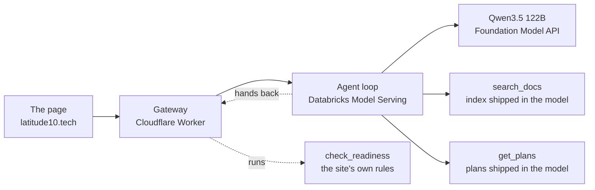

# coati-agent

The support agent of [Latitude 10](https://latitude10.tech), rebuilt on
Databricks as a small, readable harness: a tool-calling loop, retrieval over
the docs, MLflow tracing, an eval set and a serving endpoint.

- **Try it:** [latitude10.tech/labs/databricks-agent](https://latitude10.tech/labs/databricks-agent).
  Ask about the platform, the plans or the docs, or give it the URL of an
  OpenAPI document to score. Each answer shows its sources and how it got there.
- **See how it works, in pictures:** [How the Agent Lab Works](https://claude.ai/artifact/BRioQZS1C2XbXrErPkHqSc)

## How it works



1. **The page** sends the question to a **gateway** on the site. The gateway
   validates it, throttles each visitor, and later scrubs the trace down to
   step names, times, tokens and links before the browser sees it.
2. **The agent** is a plain loop in `src/coati_agent/agent.py`: ask the model,
   run the tools it asks for, repeat, answer. It stops after four model calls.
3. **Three tools, placed where their code and data live.** `search_docs` and
   `get_plans` run inside the agent. `check_readiness` is handed back to the
   gateway, which runs the site's readiness rules and resumes the turn.
4. **Every turn is traced** in MLflow, and a daily job deletes traces after 30
   days. No tool writes anything, so a prompt injection can at worst produce a
   wrong answer.

## Results

The same 40 questions went to this agent and to the support chat it replaces
(Claude Haiku 5.5, no tools), scored by Databricks' managed judge. Details in
[`evals/RESULTS.md`](evals/RESULTS.md) and [`evals/README.md`](evals/README.md).

| | This agent | The old chat |
|---|---|---|
| Facts answered right | 18/24 | 6/24 |
| Facts only the docs have | 12/16 | 1/16 |
| Refused, said "don't know" or ignored an injection | 13/13 | 13/13 |
| Ran the readiness check when given a spec | 3/3 | 0/3 |
| Median time to answer | 3.4 s | 1.3 s |

It's slower because it searches before it answers. The evals also chose the
model: Qwen3.5 122B against GPT OSS 120B and Llama 3.3 70B.

## Why it's built this way

- **No framework.** The loop is a few dozen lines, so you can read the whole
  thing.
- **No Vector Search.** The docs are under a hundred chunks, so the index
  ships inside the agent and search is a cosine scan in memory. An endpoint
  that can't scale to zero would sit idle most of the day.
- **The model is a setting.** The eval set picks it, not taste.
- **Tool descriptions are routing rules.** When `get_plans` claimed "any
  question about a plan", docs questions went to it; narrowing its words fixed
  that without a code change.

## Develop

Needs Python 3.12+, [uv](https://docs.astral.sh/uv/) and the Databricks CLI.

```
uv sync
uv run pytest
uv run ruff check . && uv run ruff format --check .
databricks auth login --host <workspace-url> --profile coati-free
databricks bundle validate -t dev
```

## Deploy

Two targets in `databricks.yml`, each tied to a CLI profile by name:

| Target | Profile | Workspace | `get_plans` |
|---|---|---|---|
| `dev` | `coati-free` | Free Edition, for building and evals | the Unity Catalog function on a SQL warehouse |
| `prod` | `coati-paid` | the workspace behind the public page | the `plans.jsonl` shipped in the model |

Log in under those profile names, or change `workspace.profile` in your copy.
`data/` already holds the site's export (rules, summary, docs, plans, with a
manifest of hashes), so there's nothing to fetch first.

The first deploy goes in two passes, because the serving endpoint needs a
registered model and the model needs the schema and the index:

```
# 1. Schema, volume and jobs. The endpoint fails here until a model exists.
databricks bundle deploy -t dev

# 2. The docs index in the artifacts volume.
databricks bundle run -t dev embed_docs

# 3. dev only: the plans table and get_plans function, on a SQL warehouse
#    (set warehouse_id in databricks.yml first, or pass --var to step 1).
databricks bundle run -t dev load_plans

# 4. Log and register the model. It runs one real prediction first, so a
#    broken model fails here. It prints the version and the experiment.
DATABRICKS_CONFIG_PROFILE=coati-free uv run python scripts/log_model.py \
    --warehouse-id <warehouse id>                 # dev
DATABRICKS_CONFIG_PROFILE=coati-paid uv run python scripts/log_model.py \
    --schema coati_agent                          # prod: no warehouse

# 5. Serve that version, with traces going to that experiment.
databricks bundle deploy -t dev --var model_version=<n> --var experiment_id=<id>
```

Then ask it something:

```
DATABRICKS_CONFIG_PROFILE=coati-free uv run python scripts/ask.py \
    "Which plan has SSO?" --endpoint dev_<you>_coati-agent
```

In `dev` the bundle prefixes names with `dev_<you>_`; in `prod` the endpoint
is `coati-agent`. A cold endpoint takes a few minutes to scale up from zero.
To serve a new version later, rerun steps 4 and 5 (and 2 after a new export).

## Evaluate

```
DATABRICKS_CONFIG_PROFILE=coati-free uv run python -m coati_agent.evals \
    --model databricks-qwen35-122b-a10b --label <label>
uv run python -m coati_agent.evals --table
```

The first writes `evals/results/<date>-<label>.json` and logs the run to
MLflow; the second regenerates `evals/RESULTS.md`. `evals/README.md` explains
the cases, the judges and every run so far.

## License

MIT
